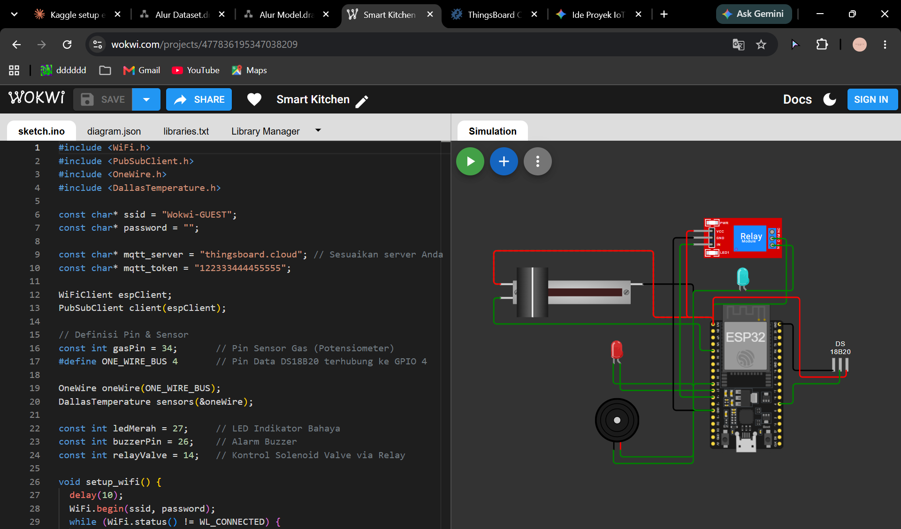

# Automatic Gas Cut-off System (ESP32 + Gas & DS18B20 + ThingsBoard, simulated in Wokwi)

A dual-sensor kitchen safety system simulated in **Wokwi**. An ESP32 reads a potentiometer (standing in for an **MQ-2** gas sensor) and a **DS18B20** temperature sensor. When gas or temperature passes its limit, it turns on a red LED and a buzzer and drives a relay that closes a solenoid valve (represented by a blue LED). Telemetry goes to **ThingsBoard Cloud** over MQTT, and ThingsBoard alarms are forwarded as notifications. Made for the Internet of Things course (Task 6 demo).

## Components
| Component | Function | Pin |
|---|---|---|
| ESP32 (Wokwi) | Controller and MQTT client | - |
| Potentiometer slider (replaces MQ-2) | Gas level (0 - 4095) | GPIO 34 |
| DS18B20 | Kitchen temperature (1-Wire) | GPIO 4 |
| Red LED | Danger indicator | GPIO 27 |
| Buzzer | Audible alarm | GPIO 26 |
| Relay module | Drives the solenoid valve | GPIO 14 |
| Blue LED | Represents the solenoid valve (on = closed) | via relay |

## Logic
| Condition | Action |
|---|---|
| `gas >= 2000` **or** `temperature >= 45 C` | Red LED on, buzzer on, relay HIGH (valve closed), status `BAHAYA (Gas/Suhu Tinggi)` |
| Otherwise | All off, relay LOW (valve open), status `Aman` |

Every 5 seconds it publishes `{"kadar_gas": <int>, "suhu": <float>, "status_sistem": "<text>"}` to `v1/devices/me/telemetry` on `eu.thingsboard.cloud` (port 1883, Access Token as MQTT username).

## ThingsBoard setup
1. Create a device and copy its Access Token.
2. Dashboard: Timeseries Line Chart and Gauge (max 4095) on `kadar_gas`, Latest Telemetry for `status_sistem`.
3. Device profile alarm rule: alarm type `Bahaya Dapur`, `kadar_gas >= 2000 OR suhu >= 45`.
4. Notifications: a Recipients group (platform users), an Alarm-type Template, and a Rule (alarm type `Bahaya Dapur`, severities Critical / Major / Warning, notify on alarm created and cleared).

| Screenshot | File |
|---|---|
| Latest telemetry | `images/thingsboard-telemetry.png` |
| Recipients, template, rules | `images/notif-*.png` |
| Alarm list and inbox | `images/alarm-list.png`, `images/notif-inbox.png` |
| Local Flask monitor | `images/flask-monitor.png` |

## Local web monitor (Flask)
The report also describes a Flask app (`app.py`, `templates/index.html`, `requirements.txt`, `.env`) that polls ThingsBoard every 3 seconds, shows the gas value and status at `http://127.0.0.1:5000`, and sends a Gmail warning when gas goes above 2000. Its source was not in the files provided, so it is **not** included. Add it under `web_monitor/` and keep `.env` (ThingsBoard access, Gmail App password) out of git.

## Code
[`tugas6_gas_cutoff/tugas6_gas_cutoff.ino`](tugas6_gas_cutoff/tugas6_gas_cutoff.ino)

Libraries: `PubSubClient`, `OneWire`, `DallasTemperature` (see `tugas6_gas_cutoff/libraries.txt`).

> **Security:** the Access Token is a placeholder. Paste your own token only locally and never commit it.

## Possible Improvements
- Latch the valve closed until it is reopened manually (a physical button or a dashboard control).
- Use a normally-closed solenoid valve (fail-safe) and handle a disconnected DS18B20 (it reads -127 C).
- Add Telegram / SMS notifications and remote valve control from the dashboard.

## Authors
Amira Najihah Fadri Putri, Mareta Surya Tananjaya, Novasya Aulia Putri Hidayat, Sulthania Auliya Afandi (Kelompok 3)

## Report
Full report: [`docs/Kel3_DemoTugas5dan6_docx__1_.pdf`](docs/Kel3_DemoTugas5dan6_docx__1_.pdf)

Demo video: https://drive.google.com/file/d/1D1VUCJf5ap4WUB2Sy-4Uw9cklZKG45Ap/view?usp=sharing
